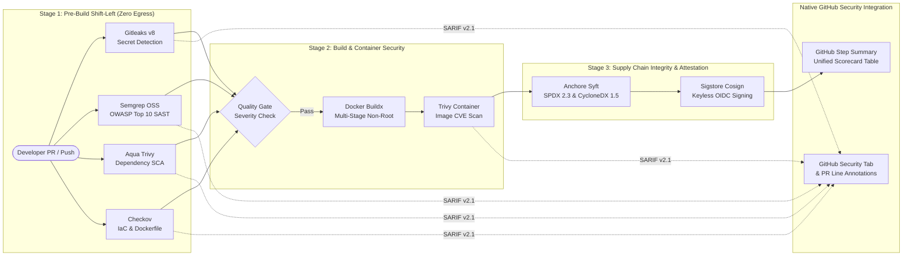

# DevSecOps Secure CI/CD Template (GitHub Actions)
> **Production-ready, reusable multi-scanner DevSecOps pipeline template. Enforces shift-left security (SAST, SCA, Secrets, IaC, Container CVEs, SBOM, and keyless Sigstore Cosign image signing) with native GitHub Security SARIF integration and zero cloud subscription overhead.**

[](https://github.com/rahulmotvani0-sketch/devsecops-secure-cicd-template/actions/workflows/devsecops-pipeline.yml)
[](https://semgrep.dev/)
[](https://trivy.dev/)
[](https://www.checkov.io/)
[](https://www.sigstore.dev/)
[](https://github.com/anchore/syft)
[](LICENSE)

---

## 📑 Table of Contents
- [Architecture & Shift-Left Pipeline Flow](#-architecture--shift-left-pipeline-flow)
- [Why This Exists & The DevSecOps Problem](#-why-this-exists--the-devsecops-problem)
- [How Any Team Adopts This (3 Lines of YAML)](#-how-any-team-adopts-this-3-lines-of-yaml)
- [Shift-Left Security Stages & Tooling](#-shift-left-security-stages--tooling)
- [Unified DevSecOps Scorecard (GitHub Step Summary)](#-unified-devsecops-scorecard-github-step-summary)
- [Tuned Policies & False-Positive Elimination](#-tuned-policies--false-positive-elimination)
- [Intentional Vulnerability Test Fixtures](#-intentional-vulnerability-test-fixtures)
- [Supply Chain Integrity (SLSA Level 3 & EO 14028)](#-supply-chain-integrity-slsa-level-3--eo-14028)
- [Local Development & Simulation](#-local-development--simulation)
- [Interview Deep-Dive & Architecture Trade-offs](#-interview-deep-dive--architecture-trade-offs)

---

## 🏛 Architecture & Shift-Left Pipeline Flow



---

## 🎯 Why This Exists & The DevSecOps Problem

Most organizations claim to practice "DevSecOps", but in reality face three catastrophic operational bottlenecks:
1. **Tool Sprawl & Fragmented Alerts:** Teams run disjointed scanners that output isolated logs across disparate web consoles, forcing developers to context-switch across 4 different dashboards.
2. **Alert Fatigue & 10,000 False Positives:** Untuned default scanner rules trigger massive noise on vendored test fixtures and low-impact warnings, leading engineering teams to disable security checks entirely.
3. **Missing Supply Chain Integrity:** Traditional CI builds produce unsigned container images with no audit trail proving *where* or *how* they were compiled, exposing production clusters to software supply chain tampering.

### The Solution:
This repository provides a **turnkey, standardized, reusable GitHub Actions template** that:
- Aggregates **all scanner outputs into native GitHub SARIF alerts** directly on Pull Request diffs.
- Features **tuned exclusion policies** (`.gitleaks.toml`, `.trivyignore`, `.checkov.yaml`) showing real engineering governance.
- Implements **SLSA Build Level 3 provenance**: generates dual-standard SBOMs (SPDX + CycloneDX) and signs images keylessly via **Sigstore Cosign**.
- Operates at **$0 cost** with zero SaaS vendor lock-in using top-tier open-source tooling.

---

## 🚀 How Any Team Adopts This (3 Lines of YAML)

Drop this single file into any repository (`.github/workflows/security.yml`):

```yaml
name: Security Quality Gate

on:
  push:
    branches: [main, develop]
  pull_request:
    branches: [main]

permissions:
  contents: read
  id-token: write          # For Sigstore Cosign keyless OIDC signing
  security-events: write   # For native GitHub Security Tab SARIF upload

jobs:
  security-gates:
    uses: rahulmotvani0-sketch/devsecops-secure-cicd-template/.github/workflows/devsecops-pipeline.yml@main
    with:
      fail_on_critical: true
      enable_sbom: true
      enable_cosign: false
      dockerfile_path: "./Dockerfile"
```

For advanced inputs and customization parameters, see the full [docs/ADOPTION_GUIDE.md](docs/ADOPTION_GUIDE.md).

---

## 🛡 Shift-Left Security Stages & Tooling

| Stage | Tool | Focus Area | Output & Integration |
|:---|:---|:---|:---|
| **Secret Scanning** | **Gitleaks v8** | Detects 140+ credential types (AWS keys, Stripe, GitHub PATs, private keys) in git commits. | Blocks PR commit; SARIF upload to GitHub Security. |
| **SAST** | **Semgrep OSS** | Analyzes source code AST for OWASP Top 10 (SQLi, Command Injection, SSRF, Deserialization). | Inline PR review annotations via SARIF. |
| **Dependency SCA** | **Aqua Trivy** | Audits Python, Go, Node, Java, and Ruby package manifests against NVD CVE databases. | Vulnerability severity filtering; SARIF upload. |
| **IaC Hardening** | **Checkov** | Evaluates Terraform, Dockerfiles, and K8s manifests against CIS Benchmarks. | Prevents misconfigurations (root containers, open ports). |
| **Container CVEs** | **Aqua Trivy** | Scans built container layers for base OS package vulnerabilities. | Enforces non-root and patched base image baselines. |
| **SBOM Generation** | **Anchore Syft** | Catalogs complete software component inventory in machine-readable formats. | Emits both **SPDX 2.3 JSON** & **CycloneDX 1.5 JSON**. |
| **Image Signing** | **Sigstore Cosign** | Cryptographically signs container images and attaches in-toto SBOM attestations. | **Keyless OIDC** via GitHub token; verified via Rekor log. |

---

## 📊 Unified DevSecOps Scorecard (GitHub Step Summary)

Upon every CI run, the workflow renders a consolidated executive summary table directly into the GitHub Actions run summary (`$GITHUB_STEP_SUMMARY`):

| Quality Gate | Tool | Target | Status | Enforced Policy |
|:---|:---|:---|:---|:---|
| **Secret Detection** | Gitleaks v8 | Git History & Tree | ✅ PASSED | Zero unencrypted credentials permitted |
| **SAST Analysis** | Semgrep OSS | Source Code | ✅ PASSED | OWASP Top 10 + CWE Security Baseline |
| **Dependency SCA** | Aqua Trivy | Manifests & Lockfiles | ✅ PASSED | CVSS Critical Block (Filtered via `.trivyignore`) |
| **IaC Hardening** | Checkov | Terraform & Dockerfile | ✅ PASSED | CIS Docker & K8s Benchmark Compliance |
| **Container Security** | Aqua Trivy | Multi-Stage Image | ✅ PASSED | Non-root runtime + Minimal attack surface |
| **Supply Chain (SBOM)** | Anchore Syft | Project Dependencies | ✅ GENERATED | SPDX 2.3 JSON & CycloneDX 1.5 JSON |
| **Integrity Signing** | Sigstore Cosign | Image & Attestation | ✅ VERIFIED | Keyless GitHub OIDC Identity (SLSA 3) |

---

## 🔧 Tuned Policies & False-Positive Elimination

Rather than using naive out-of-the-box scanner configurations that spam developers with thousands of unfixable alerts, this repository models **senior DevSecOps standard-setting**:

1. **[`.gitleaks.toml`](.gitleaks.toml):**
   * Preconfigured allowlists for verified test fixtures, mock data, and documentation examples.
2. **[`.trivyignore`](.trivyignore):**
   * Documents every suppressed CVE with **CVE ID**, **impacted package**, **technical justification / compensating control**, and **review expiration date**.
3. **[`.checkov.yaml`](.checkov.yaml):**
   * Explicitly documents skipped checks (e.g. delegating container healthchecks to Kubernetes probes rather than redundant Dockerfile directives).

---

## 🧪 Intentional Vulnerability Test Fixtures

To verify that the security gates actively catch vulnerabilities before code merges, the repository includes deliberate, documented test fixtures:

* [`test-fixtures/vulnerable-samples/vulnerable_app.py`](test-fixtures/vulnerable-samples/vulnerable_app.py):
  * **CWE-89:** SQL Injection via string formatting (`bad_query = f"SELECT * FROM users WHERE id = '{user_id}'"`).
  * **CWE-78:** Command Injection via `subprocess.Popen(..., shell=True)`.
  * **CWE-502:** Insecure Deserialization via `pickle.loads()`.
  * **CWE-798:** Hardcoded mock API credential.
* [`test-fixtures/vulnerable-samples/Dockerfile.vulnerable`](test-fixtures/vulnerable-samples/Dockerfile.vulnerable):
  * Unpinned `python:latest` base tag (CKV_DOCKER_7).
  * Hardcoded secret in `ENV` layer (CKV_DOCKER_8).
  * Runs as `root` without unprivileged `USER` declaration (CKV_DOCKER_3).
* [`test-fixtures/secure-samples/secure_app.py`](test-fixtures/secure-samples/secure_app.py):
  * The fully remediated, production-hardened counter-implementation achieving **0 scanner findings**.

---

## 📜 Supply Chain Integrity (SLSA Level 3 & EO 14028)

This template fulfills the strict requirements of **US Executive Order 14028 (Improving the Nation's Cybersecurity)** and achieves **SLSA Build Level 3**:
* **Dual Standard SBOMs:** Generates both ISO/IEC 5962 (SPDX 2.3) and OWASP CycloneDX 1.5 formats, cataloging all direct and transitive dependencies.
* **Keyless Cosign Signing:** Utilizes Sigstore's Fulcio certificate authority and OpenID Connect (OIDC) to issue short-lived certificates tied to the GitHub repository identity (`https://github.com/${{ github.repository }}`).
* **Tamper-Evident Ledger:** Signatures and in-toto SBOM attestations are published to Sigstore's public **Rekor transparency log**, allowing downstream consumers to verify provenance without trusting arbitrary private keys.

---

## 💻 Local Development & Simulation

Run the quality gates locally before pushing code:

```bash
# Run the colored terminal pipeline simulator
./scripts/simulate_pipeline.sh

# Run individual scanners via Makefile
make scan-secrets  # Gitleaks
make scan-sast     # Semgrep
make scan-sca      # Trivy SCA
make scan-iac      # Checkov

# Run demonstration gates
make demo-fail     # Scans vulnerable fixtures (demonstrates failure detection)
make demo-pass     # Scans hardened microservice (demonstrates clean pass)
```

---

## 🎤 Interview Deep-Dive & Architecture Trade-offs

When presenting this project in a senior DevOps / DevSecOps interview (e.g. micro1):

### 1. Shift-Left Philosophy: Fail Fast vs. Developer Productivity
* **Question:** *"How do you balance pipeline security gates without blocking developer velocity?"*
* **Talking Point:** "We split checks into two tiers: fast, synchronous pre-build gates (Gitleaks, Semgrep, Checkov) run in under 45 seconds to provide immediate feedback on PRs. Heavy dynamic scans or deep image scans are decoupled or cached. Furthermore, we tune policies via `.trivyignore` and `.gitleaks.toml` so developers never face alert fatigue from accepted low-risk dependencies."

### 2. Keyless Cosign vs. Traditional GPG/SSH Image Signing
* **Question:** *"Why did you implement keyless Cosign instead of traditional GPG keys in GitHub Secrets?"*
* **Talking Point:** "Traditional private signing keys stored in CI secrets present a catastrophic single point of failure—if the secret leaks, an attacker can sign malicious images forever. With Sigstore keyless OIDC, the signing identity is ephemeral and bound strictly to the GitHub Actions workflow runner context, with auditability guaranteed by the public Rekor transparency log."

### 3. Tooling Selection Rationale
* For a detailed architectural comparison matrix comparing Semgrep vs. SonarQube, Trivy vs. Snyk, and Cosign vs. Notary, see [docs/TOOLING_COMPARISON.md](docs/TOOLING_COMPARISON.md).

---

## 👤 Author & Connect
**Rahul Motvani**  
DevOps & DevSecOps Engineer · SRE  
- **Portfolio:** [rahul.techiking.com](https://rahul.techiking.com)
- **LinkedIn:** [linkedin.com/in/rahul-motvani-720b8b18a](https://www.linkedin.com/in/rahul-motvani-720b8b18a/)
- **GitHub:** [github.com/rahulmotvani0-sketch](https://github.com/rahulmotvani0-sketch)
- **Email:** [rahulmotvani8@gmail.com](mailto:rahulmotvani8@gmail.com)
